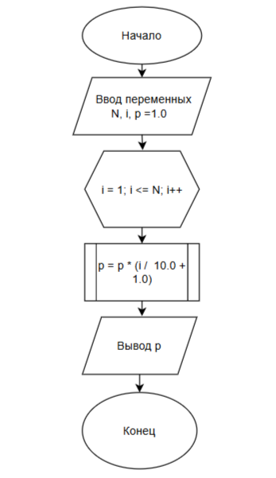

# Домашнее задание к работе 8

## Условие задачи
Вычислите для целого N, заданного пользователем, значение произведения 1,1 * 1,2 * 1,3 * ...1,N
## 1. Алгоритм и блок-схема

### Алгоритм
  **Начало**
 
  **Конец**

### Блок-схема[

[https://github.com/uliases00/domashnya-8/blob/main/dz8.png]


## 2. Реализация программы

```c

```

## 3. Результаты работы программы


## 4. Информация о разработчике

Черкасова Ульяна бТИИ-261
